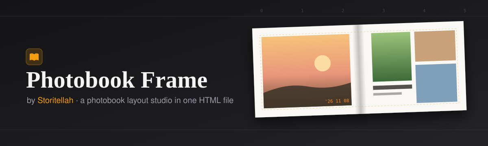
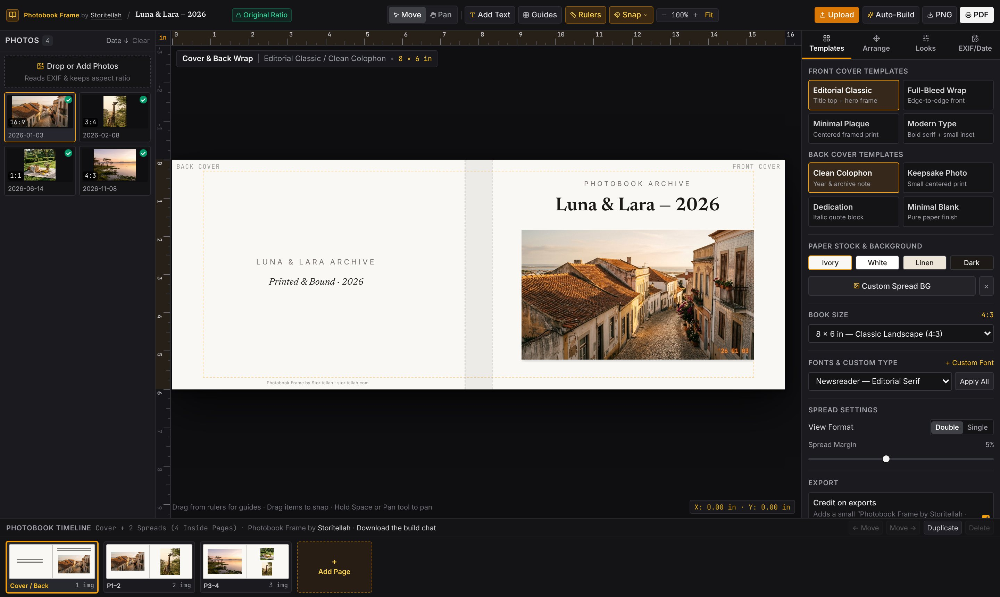
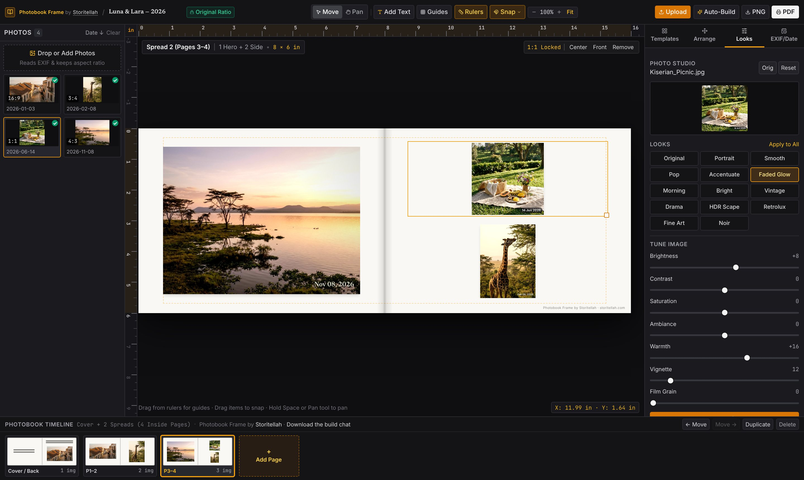
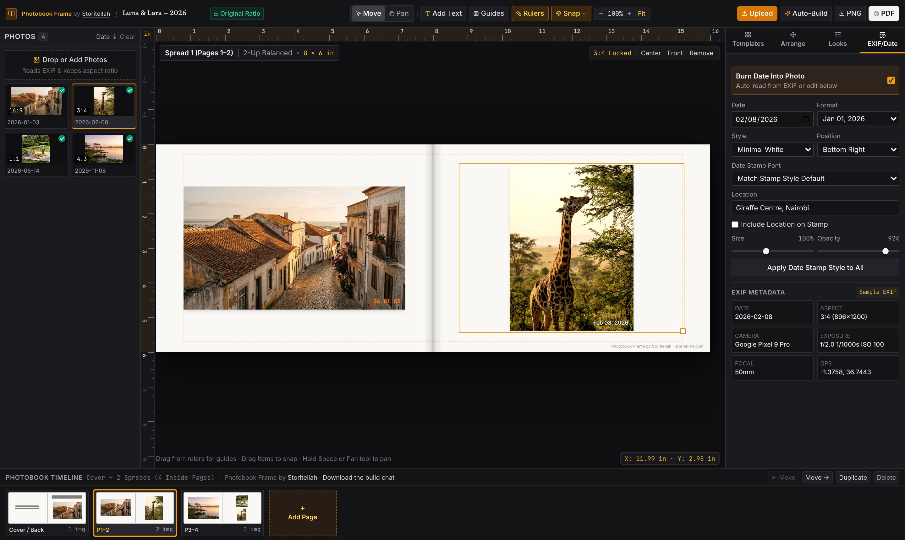
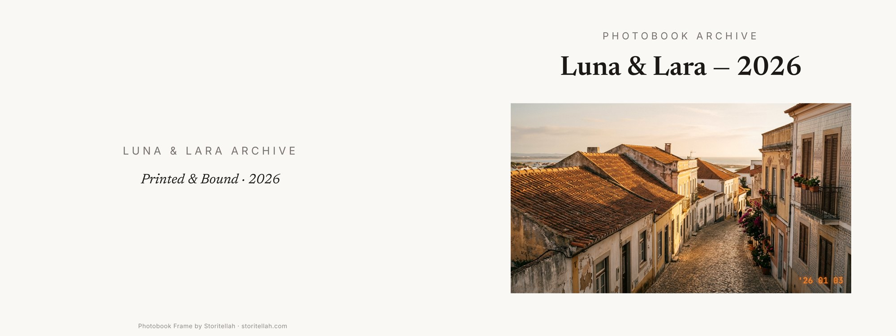
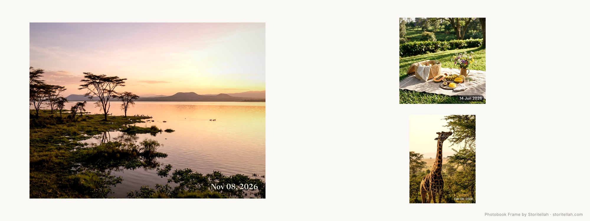

  

  
  
  
  

  <b>Photobook Frame</b> by <a href="https://storitellah.com">Storitellah</a> is a photobook layout studio that runs in your browser. 
  Build a cover wrap and double-page spreads, keep every photo at its original ratio, add film looks and date stamps, then print a true-size PDF.

---

  

## What it does

<table>
  <tr>
    <td width="33%" valign="top">
      <h3>📖 Cover &amp; spreads</h3>
      Four front-cover and four back-cover templates for the wrap, plus six double-spread layouts: 2-up, panorama, hero + 2, 3-up gallery, 4-up and story + photo. <b>Auto-Build</b> sorts your photos by date and lays out the whole book.
    </td>
    <td width="33%" valign="top">
      <h3>🖼️ Zero-crop frames</h3>
      Photos keep their original aspect ratio by default. Unlock a frame to zoom and pan inside it, and the export uses exactly the crop you see on screen.
    </td>
    <td width="33%" valign="top">
      <h3>🎞️ Film looks</h3>
      Fourteen one-tap looks (Portrait, Faded Glow, Vintage, HDR Scape, Noir…) and seven sliders: brightness, contrast, saturation, ambiance, warmth, vignette and grain. Apply one look to every photo at once.
    </td>
  </tr>
  <tr>
    <td valign="top">
      <h3>📅 EXIF date stamps</h3>
      Reads the date, camera, exposure and GPS from each photo's EXIF and can burn the date in as 35 mm amber, minimal white, editorial serif or a frosted pill, with an optional location.
    </td>
    <td valign="top">
      <h3>📐 Rulers, guides &amp; snapping</h3>
      Rulers in inches, centimetres or pixels. Drag guides out of the rulers, and items snap to the grid, page centres, safe margins, other items and your guides.
    </td>
    <td valign="top">
      <h3>🔤 Typography</h3>
      Fourteen built-in fonts (editorial serifs, clean sans, handwritten, mono). Load any Google Font by name or upload your own TTF, OTF or WOFF file.
    </td>
  </tr>
  <tr>
    <td valign="top">
      <h3>📏 Real book sizes</h3>
      8×6, 11×8.5, 12×9, 8×8, 10×10, 12×12, 8×10 and 8.5×11 in, or a custom size in inches or centimetres. Ivory, white, linen or dark paper, or your own background image per spread.
    </td>
    <td valign="top">
      <h3>🖨️ Print-ready output</h3>
      Export any spread as a 300 dpi PNG, or print the whole book with one page per spread at the book's true size. Choose <i>Save as PDF</i> to send it to a print shop.
    </td>
    <td valign="top">
      <h3>🔒 Private by design</h3>
      Everything happens in your browser. Photos are never uploaded anywhere.
    </td>
  </tr>
</table>

<table>
  <tr>
    <td width="50%"></td>
    <td width="50%"></td>
  </tr>
  <tr>
    <td align="center">Looks: presets, live preview and tuning sliders</td>
    <td align="center">EXIF/Date: date stamps and photo metadata</td>
  </tr>
</table>

### What the export looks like

  
  

Each export carries a small "Photobook Frame by Storitellah · storitellah.com" line. Turn it off under <b>Templates → Export → Credit on exports</b>.

## Use it

**Online:** open **[storitellah.github.io/tools-by-storitellah/PhotobookFrame](https://storitellah.github.io/tools-by-storitellah/PhotobookFrame/)**.

**Offline:** download [`index.html`](index.html) and open it in any modern browser. The four sample photos are built into the file. Styling, icons and fonts load from public CDNs, so you need a connection the first time.

1. **Upload** photos, or drop them anywhere on the window. Use **Clear** to remove the samples.
2. Pick a cover template, then click **Auto-Build** or add spreads from the timeline.
3. Click a photo in the library to add it to the open spread. If a photo on the spread is selected, the click replaces it instead.
4. Drag items to move them and use the corner handle to resize. Double-click text to edit it, or double-click a photo to open its Looks.
5. Click **PNG** for the open spread, or **PDF** for the whole book. In the print dialog choose *Save as PDF*, with margins set to *None* and scale at *100%*.

### Keyboard

| Key | Action |
| --- | --- |
| <kbd>V</kbd> / <kbd>H</kbd> | Move tool / Pan tool |
| <kbd>Space</kbd> (hold) | Pan the desk |
| <kbd>R</kbd> | Show or hide rulers |
| <kbd>←</kbd> <kbd>→</kbd> | Previous / next spread |
| <kbd>Delete</kbd> | Remove the selected item |
| <kbd>Esc</kbd> | Deselect |
| Mouse wheel | Zoom the desk |

## Bugs fixed in this version

The tool arrived as a single HTML file. Before publishing it, each of these was reproduced in a headless browser and then fixed:

| Area | What went wrong | Now |
| --- | --- | --- |
| Rendering | Dragging any slider started overlapping renders. Each one appended its own copy of every photo, so 2 photos became 28 elements. | Only the newest render touches the page. |
| Spread margin | Every step of the margin slider re-added the story template's text boxes (8 copies after a short drag) and dropped any extra photos. | Re-flows the layout and keeps your text and photos. |
| Cover templates | Switching templates swapped the front and back photos and deleted any text you'd added. | Photos keep their front/back slot and your text stays. |
| Inside templates | Switching layouts threw away your own text boxes. | Your text stays, and empty slots fill from unused photos first. |
| New page | **Add Page** made an empty spread despite its "Story + Photo" template. | It's built from its template. |
| Keyboard | Holding Space to pan also clicked the last button you'd pressed, e.g. adding another text box. The shortcuts V, H and R named in the tooltips did nothing. | Space only pans, and the shortcuts work. |
| Double-click | "Double-click to edit" never worked, because the first click rebuilt the spread. | Selecting no longer rebuilds the spread, and double-click opens the editor. |
| Export text | Text in PNG/PDF exports was squeezed onto one line rather than wrapped, ignored letter-spacing, and wrapped differently from the screen. | Same wrapping, spacing and optical size as on screen. |
| Pan & zoom | On screen, zoom happened around the centre while the export zoomed around the pan point, so prints were cropped differently. | Preview and export crop are identical. |
| Background | Custom spread backgrounds were stretched in exports. | Scaled to cover, as on screen. |
| Print | Pages printed at Letter size with margins, at about 110 dpi, sometimes before the fonts had loaded. | One page per spread at the book's true size, 300 dpi, after the fonts load. |
| Dark paper | Text stayed near-black on the dark paper and disappeared. | Default text colours follow the paper. |
| Uploads | Unreadable files (e.g. HEIC outside Safari) were added as broken, empty photos. A damaged EXIF block made a good photo fail to import. Dropping a file outside the small drop box opened it in the tab and lost the book. | Unreadable files are reported. Bad EXIF is skipped. You can drop photos anywhere. |
| Memory | Every slider position cached another full-size JPEG, so a few drags held tens of MB. | One cached render per photo. |
| Fonts | Date stamps painted before the web fonts loaded stayed in the fallback font. **Load Google Font** didn't wait for the font and accepted names that don't exist. | Stamps repaint once fonts arrive. Google Fonts are checked and loaded before use. |
| Safari | Safari before 18 has no canvas filters, so every look and slider was silently ignored. | A pixel fallback gives the same result (within 1/255 on average). |
| Rulers | Rulers, grid and snapping used a different custom-size clamp from the page, and rulers were measured mid-zoom. | They share one size and redraw after zooming. |
| Smaller things | The cover could be duplicated into an inside page. The Looks tab kept showing a deleted photo. Uploads without EXIF used the UTC date. Unsaved work could be closed without warning. | All fixed. |

The visible "Snapseed" labels were also renamed to **Looks** / **Photo Studio**, since Snapseed is Google's product name.

## Build chat

[`CHAT.md`](CHAT.md) is the conversation this tool was prepared in. A copy is embedded in `index.html`, so the **Download the build chat** link in the app's timeline bar works even when the file is used on its own. After editing `CHAT.md`, refresh the embedded copy with `python3 Scripts/embed_chat.py PhotobookFrame`.

---

Photobook Frame · made by <a href="https://storitellah.com">Storitellah</a>

